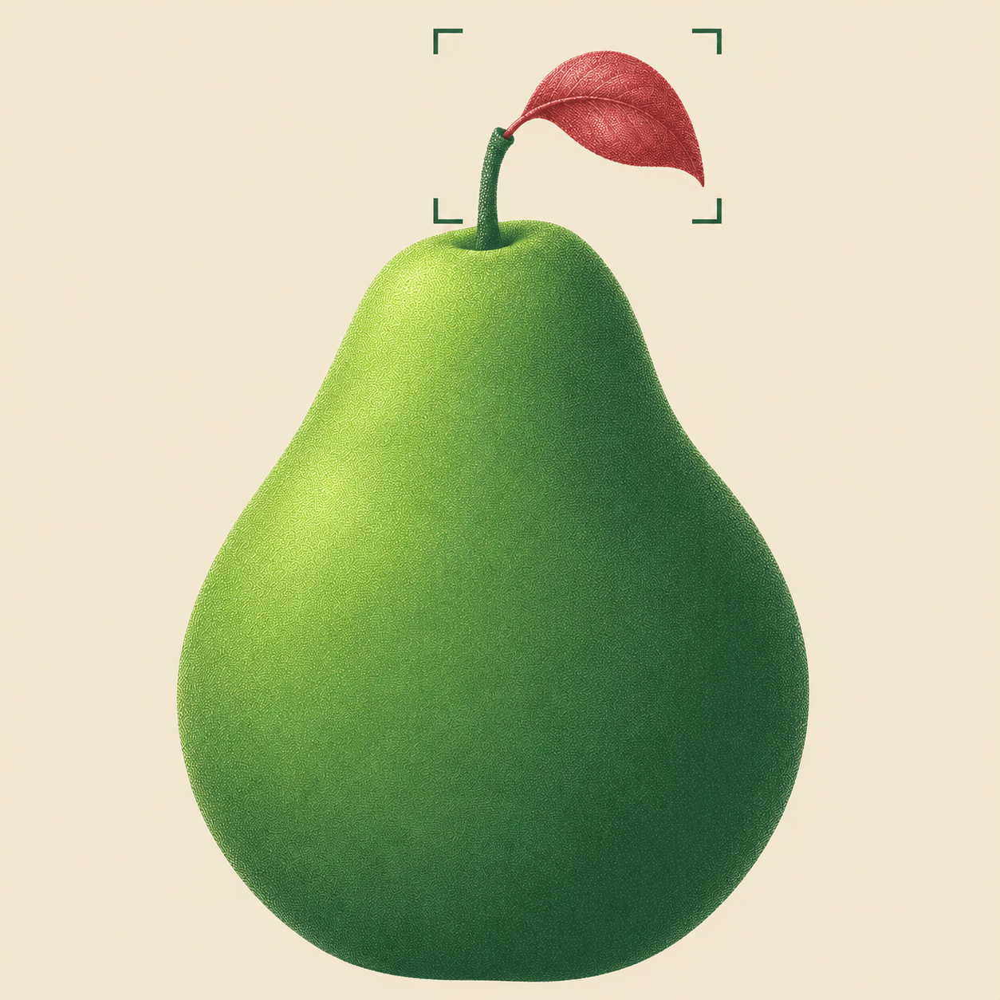

# imagegen

[](https://github.com/jerrydboonstra/imagegen/actions/workflows/tests.yml) [](LICENSE)
[![neckbeard report: 0.2.4 · read in full](https://img.shields.io/badge/neckbeard%20report-0.2.4%20%C2%B7%20read%20in%20full-brightgreen?logo=data%3Aimage%2Fsvg%2Bxml%3Bbase64%2CPHN2ZyB4bWxucz0iaHR0cDovL3d3dy53My5vcmcvMjAwMC9zdmciIHZpZXdCb3g9IjAgMCAyNCAyNCI%2BPG1hc2sgaWQ9Im0iPjxyZWN0IHdpZHRoPSIyNCIgaGVpZ2h0PSIyNCIgZmlsbD0iI2ZmZiIvPjxwYXRoIGQ9Ik02LjYgOC4yIDEwLjkgOS42IDEwLjYgMTAuNiA2LjMgOS4yWiBNMTcuNCA4LjIgMTMuMSA5LjYgMTMuNCAxMC42IDE3LjcgOS4yWiIgZmlsbD0iIzAwMCIvPjxyZWN0IHg9IjgiIHk9IjExLjEiIHdpZHRoPSIyLjIiIGhlaWdodD0iMS4xIiBmaWxsPSIjMDAwIi8%2BPHJlY3QgeD0iMTMuOCIgeT0iMTEuMSIgd2lkdGg9IjIuMiIgaGVpZ2h0PSIxLjEiIGZpbGw9IiMwMDAiLz48cGF0aCBkPSJNOS44IDE2LjIgQzExIDE1LjQgMTMgMTUuNCAxNC4yIDE2LjIgTDEzLjkgMTYuOSBDMTIuOCAxNi4zIDExLjIgMTYuMyAxMC4xIDE2LjlaIiBmaWxsPSIjMDAwIi8%2BPC9tYXNrPjxnIG1hc2s9InVybCgjbSkiIGZpbGw9IiNmZmYiPjxjaXJjbGUgY3g9IjciIGN5PSI3LjIiIHI9IjMuNCIvPjxjaXJjbGUgY3g9IjEwLjMiIGN5PSI0LjYiIHI9IjMuNCIvPjxjaXJjbGUgY3g9IjEzLjciIGN5PSI0LjYiIHI9IjMuNCIvPjxjaXJjbGUgY3g9IjE3IiBjeT0iNy4yIiByPSIzLjQiLz48ZWxsaXBzZSBjeD0iMTIiIGN5PSIxMC41IiByeD0iNi44IiByeT0iNi44Ii8%2BPHBhdGggZD0iTTQuNiAxMS41IEM0LjIgMTYgNS44IDE5LjYgOC4yIDIxLjQgTDkuNiAyMyAxMSAyMiAxMiAyMy42IDEzIDIyIDE0LjQgMjMgMTUuOCAyMS40IEMxOC4yIDE5LjYgMTkuOCAxNiAxOS40IDExLjUgWiIvPjwvZz48L3N2Zz4%3D)](docs/neckbeard-report.md)

**imagegen lets Claude Code make images and edit them the way you edit code: change one part, and the rest stays exactly as it was. It runs on Codex CLI's image generator and your own ChatGPT login, so you stop pasting prompts into ChatGPT and screenshots back.**

What changed in each release: [CHANGELOG.md](./CHANGELOG.md), newest first.

## Install

Paste this into Claude Code (in the terminal, or in the Code tab of the Claude desktop app):

> Install the plugin imagegen from the marketplace jerrydboonstra/imagegen: run `claude plugin marketplace add jerrydboonstra/imagegen`, then `claude plugin install imagegen@imagegen`. Then run its doctor, `skills/imagegen/doctor.sh` in the installed plugin (it sits under `~/.claude/plugins/cache/imagegen/imagegen/<version>/`). Tell me in plain words what is missing and how to fix each one, and tell me to run /reload-plugins.

Or type this one line in Claude Code (version 2.1.275 or later):

```
/plugin install imagegen --marketplace jerrydboonstra/imagegen
```

It asks you to confirm the marketplace (press `y`), then where to install: pick the option "for you", the first one listed.

Or run these two lines in a shell:

```bash
claude plugin marketplace add jerrydboonstra/imagegen
claude plugin install imagegen@imagegen
```

It needs Claude Code, and Codex CLI logged in to a paid ChatGPT plan. Starting from nothing? [Set up from zero](#set-up-from-zero) walks through Homebrew, Claude Code, Codex, Pillow and ImageMagick.


Then ask in plain words, for example: "make a simple flat logo of a green pear on a white background".

Once you have the image, you usually want to improve it a step at a time, and each step should change one thing and leave the rest alone. An image model won't do that. Ask it to fix one leaf and it redraws the whole picture, so the background shifts, the texture moves and the colours drift. imagegen's box mode keeps only the part you meant to change and pastes it back onto the original, so every pixel outside the box stays exactly as it was, for 8-bit RGB or RGBA originals saved as PNG or lossless WebP.

## What it does

- **Makes images from a prompt.** Logos, icons, social cards, illustrations, mockups. The session writes the prompt, runs Codex, and looks at the result before showing it to you.
- **Edits an image you already have.** Give it a reference image and say what to keep and what to change.
- **Keeps the rest of the picture.** Box mode pastes only the changed region back onto the original. You name the region as a box, or let `--auto` pick it; `--auto` takes a generous region, so a box is the tighter choice.
- **Makes several images in one go**, each saved under its own name.
- **Codex keeps its own copy of each image** under `~/.codex/generated_images/<session>/`, which `SKILL.md` names as the place to look.
- **Falls back to an SVG drawn by hand when Codex is missing**, and tells you what to install.

## How box mode works

An edit through the model is a redraw. On the stippled pear, recolouring one leaf changed 99% of the pixels outside it.

Box mode works around that in three steps:

1. Choose the box before you prompt: the region you want to change, in the original's pixels.
2. Make the edit as usual. It comes back redrawn, often at a different size.
3. `composite.py` scales the edit to the original's size, cuts out the box, softens its edge on the inside, and pastes it onto the original.

Claude runs `composite.py` for you. To run it by hand, you need the plugin's files: the installed copy in `~/.claude/plugins/cache/imagegen/imagegen/<version>/` has them, and so does a clone of this repo. From either folder:

```bash
python3 skills/imagegen/composite.py original.png edit.png result.png --box=X,Y,W,H
```

Everything outside the box is the original's, pixel for pixel, when you save as PNG or WebP. An offline test checks it with synthetic images, for 8-bit RGB and RGBA originals, saved as PNG and as lossless WebP (`tests/box-guarantee.sh`). JPEG is lossy, so it can't stay exact, and `composite.py` warns you.

## Every image keeps its recipe

Each image the skill saves gets a `<name>.recipe.md` beside it: the whole prompt as sent to Codex, each input image with its sha256, the Codex CLI version and the date, the recipe of the image it was edited from, and for a box paste-back the box and the `composite.py` command. Paths in a recipe are relative to the recipe file.

One run made three: `apple.png` (generated), `apple-green.png` (an edit; its recipe names `apple.recipe.md` as its parent and lists `apple.png` with its hash) and `apple-boxed.png` (the paste-back; its recipe holds `--box=440,420,370,420` and the command).

The image model draws something different on every run, so a recipe records how an image was made and lets you make another like it. It does not bring back the same pixels.

## Set up from zero

imagegen runs only in Claude Code, on your own computer: in the terminal, or in the Code tab of the Claude desktop app. It does not run in Cowork or in claude.ai chat, because the skill runs Codex and other shell commands on your machine.

On a Mac, first install Homebrew, a tool that installs the others, by pasting this into Terminal:

```bash
/bin/bash -c "$(curl -fsSL https://raw.githubusercontent.com/Homebrew/install/HEAD/install.sh)"
```

Then you need, in this order:

1. **Claude Code.** On a Mac, run `curl -fsSL https://claude.ai/install.sh | bash`, open a new terminal (on a Mac, search for Terminal in Spotlight), and run `claude` to log in. Other systems: [Anthropic's setup page](https://code.claude.com/docs/en/setup). It needs a Claude Pro, Max, Ultra, Team, Enterprise or Console account; the free plan does not include it.
2. **Codex CLI, logged in to your ChatGPT account.** Install it from [OpenAI's Codex CLI page](https://learn.chatgpt.com/docs/codex/cli) (on a Mac or Linux: `curl -fsSL https://chatgpt.com/codex/install.sh | sh`). Then run `codex login` yourself and check it with `codex login status`. imagegen never touches the credential file. Image generation is not on the Free ChatGPT plan, and each image counts against your plan's Codex usage limits, several times faster than a text turn.
3. **Python 3 with Pillow** (a Python image library), which box mode needs and the doctor (below) checks for. The doctor can set it up when yours has none.
4. **ImageMagick**, recommended, for resizing and quick checks: `brew install imagemagick` on a Mac. The doctor offers to install it.

Then add the plugin with any of the three ways under [Install](#install) at the top of this page.

The install prints `Successfully installed plugin`. Start Claude Code again to load it, or run `/reload-plugins` in a session that is already open. To check that it loaded, run `claude plugin list`, or type `/` in a session and look for `/imagegen:imagegen`. The Code tab shares these settings, so the plugin shows up there too.

To make your first image, make a folder for your pictures, go into it in the terminal (`cd` followed by the folder's path) and start `claude` (or open that folder in the Code tab) and ask in plain words, for example: "make a simple flat logo of a green pear on a white background". The first time, the skill runs the doctor and tells you what is missing. It works in a folder of its own, or in your project's folder for rounds of edits, and saves the image there with its `<name>.recipe.md` beside it.

On a Linux box with no browser, Codex's device-code login may be refused. Log in through a port forward instead: `ssh -t -L 1455:localhost:1455 <host> 'codex login'`, then open the printed link in your local browser.

## Doctor

Ask Claude to "run the imagegen doctor". It checks that everything in Set up from zero is in place and offers to fix what is missing: Codex installed and logged in, Python with Pillow, ImageMagick (recommended, not required). It prints one line for each, with the fix for any that fails, and asks before it installs anything. The skill also runs it before your first image. To run it yourself, from `~/.claude/plugins/cache/imagegen/imagegen/<version>/` (or from a clone of this repo): `bash skills/imagegen/doctor.sh`.

## Worked example: the pear's leaf

The logo at the top of this page was made with imagegen.

- **The pear came first**, a green pear drawn in fine dots, with a red leaf framed by four corner marks.
- **The new leaf came from edits.** Each was made from the last good image, with a prompt that listed what to keep and one thing to change.
- **Each edit redrew the whole picture.** Measured on a later recolour of the leaf, 99% of the pixels outside it changed, by about 4% (RMS).
- **Box mode stops that.** The first time, it couldn't run: the machine had no Pillow, which is why imagegen now has a doctor. Pasting the recoloured leaf back through a box left every pixel outside the box identical to the original (none of the 1.5 million differed).
- **The last fix was by hand.** One corner mark sat a little off. Moving it a few pixels was a job for ImageMagick.

## The rules it keeps

- **It spends your ChatGPT plan.** A few images at a time is fine. It asks before a batch of more than about ten, or before looping until something passes.
- **Nothing it makes goes public without your OK.** Not into a public repo, a README, a social card or a post.
- **No secrets or personal data in prompts.** Prompts go to OpenAI, so it keeps out keys, private names and anything personal.
- **It looks before it shows you.** It reads each image against the brief and passes on only the ones worth your time.

## License

MIT. By Jerry Boonstra. What changed in each release: [CHANGELOG.md](./CHANGELOG.md), newest first.
